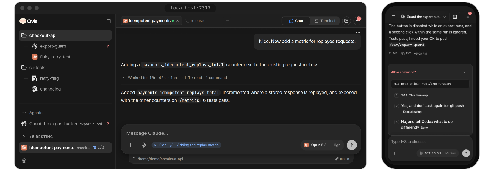

<p align="center">
  
</p>

<h1 align="center">Ovis</h1>

<p align="center">
  <strong>コーディングエージェントを、デスクトップ、スマートフォン、ブラウザーで。</strong>
  <br>
  自分のコンピューターで動く Claude Code や Codex などのエージェントとチャットし、タップひとつで答えられます。
</p>

<p align="center">
  <a href="LICENSE"></a>
  <a href="https://github.com/devswha/ovis/releases/latest"></a>
  <a href="https://github.com/devswha/ovis/stargazers"></a>
  <a href="https://github.com/herdrdev/herdr"></a>
</p>

<p align="center">
  <a href="README.md">English</a> · <a href="README.zh-CN.md">简体中文</a> · <strong>日本語</strong> · <a href="README.ko.md">한국어</a>
  <br>
  <a href="https://ovis.sh/">公式サイト</a> ·
  <a href="#install">インストール</a> ·
  <a href="https://ovis.sh/demo/">デモ</a> ·
  <a href="docs/guide.md">ドキュメント</a> ·
  <a href="https://ovis.sh/discord">Discord</a>
</p>

<p align="center">
  <a href="https://ovis.sh/demo/"></a>
</p>

Ovis は、エージェントが作業しているコンピューター上で動き、スマートフォンやどのブラウザーからでもそこに接続できます。[herdr](https://github.com/herdrdev/herdr) を基盤としており、herdr や [Herdr アプリ](https://herdr.dev/download/)で見ているのと同じ、実際に動いているターミナルを表示できるので、両方を一緒に使えます。[それぞれの関係 →](docs/guide.md#how-ovis-fits-with-herdr)

<a id="install"></a>

## インストール

**デスクトップアプリ：** [Mac](https://ovis.sh/Ovis-mac-arm64.dmg)（[Intel](https://ovis.sh/Ovis-mac-x64.dmg)）· [Windows](https://ovis.sh/Ovis-win-x64.exe) · [Linux](https://ovis.sh/Ovis-linux-x64.deb)（[すべてのビルド](docs/guide.md#the-desktop-app)）。ほかに何も要りません。ターミナルは、このアプリが独自に起動したものだけが表示されます。herdr や Herdr アプリですでに使っているターミナルを見るには、デスクトップアプリではなく下のコマンドでインストールしてください。

**herdr や Herdr アプリを使っている場合：** コマンド 1 行で Ovis を一緒に入れられます。Linux か macOS で：

```bash
curl -fsSL https://ovis.sh/install.sh | sh
```

Windows では PowerShell で：

```powershell
irm https://ovis.sh/install.ps1 | iex
```

**スマートフォンで：** iPhone アプリは [App Store](https://apps.apple.com/app/id6824664162)、Android アプリは [Google Play](https://play.google.com/store/apps/details?id=sh.ovis.app) にあります。アプリはサインイン画面から始まります。[スマートフォンの設定 →](docs/guide.md#on-your-phone)

<a href="https://apps.apple.com/app/id6824664162"></a> <a href="https://play.google.com/store/apps/details?id=sh.ovis.app"></a>

## どこからでも自分の PC へ

GitHub、Google、Apple のいずれかで Ovis アカウントにサインインすると（最初のサインインでアカウントができます）、アカウントに入っているコンピューターがほかのデバイスに表示されます。Mac・Windows・Linux のデスクトップアプリ、iPhone と Android のアプリ、そして [app.ovis.sh](https://app.ovis.sh) を開いた任意のブラウザです。アプリはコンピューターと同じ Wi-Fi や Tailscale にあれば直接つながり、そうでないときとブラウザではエンドツーエンドで暗号化された Ovis リレーを通ります。ネットワーク側の設定はいりません。[アカウントのしくみ →](docs/guide.md#through-an-account)

- **コンピューターを追加。** そのコンピューターで **設定 → デバイスと PC → アカウント** を開き、サインインしてこの PC を追加します。新しいアカウントの最初のコンピューターや、2 段階サインインの直後に追加するコンピューターは、その一回で入れることがあります。そうでなければ、同じアカウントにサインインしたスマートフォンで仕上げます。コンピューターで **接続を追加 → スマホ・デバイス** を開いてリレーをオンにし、**QR コードを表示する** を押して読み取ります。
- **スマートフォンやほかのデバイスを追加。** そのデバイスで同じアカウントにサインインし、コンピューターを開きます。承認を求められたら、そのコンピューター、またはすでにそのコンピューターを使っているデバイスで承認します。
- **アカウントなしで。** Tailscale、同じ Wi-Fi、SSH でも使えます。スマートフォンでは **サインインせずに始める**、デスクトップでは **接続を追加 → Tailscale** または **直接接続** を選びます。Android アプリは SSH でコンピューターに直接つなぎ、そこに Ovis をインストールすることもできます。[リモート PC →](docs/remote-pcs.md)

## 機能

- **エージェントをチャットで。** Claude Code、Codex [など](docs/guide.md#supported-agents)。1 ターンのコマンドや編集は 1 行にまとまります。
- **確認や質問はカードで。** タップで答えます。
- **プッシュ通知。** アプリを閉じていても届きます。
- **本物のターミナルをワンクリックで。** スマートフォンにはキーバー付き。
- **どこからでも新しいエージェントを開始。** 選んだフォルダーで、デスクトップからでもスマートフォンからでも。
- **すべてのワークスペースをひとつのリストに。** リレーや SSH でつないだ自分の別の PC も。
- **好きなブラウザで。** **設定 → エージェント** で Claude Code、Codex、GitHub Copilot にブラウザツール（Chrome DevTools MCP または Playwright MCP）を持たせ、デスクトップアプリでは選んだブラウザでリンクを開けます。

[すべての機能 →](docs/guide.md#features)

<details>
<summary>動いている様子を見る（25 秒の動画）</summary>
<p align="center">
  <a href="https://ovis.sh/demo/"></a>
  <br>
  <sub>ブラウザーで動く<a href="https://ovis.sh/demo/">デモ</a>で収録しました。</sub>
</p>
</details>

**制約：** 自分のコンピューターが起動していて、接続できる状態である必要があります（Ovis リレー、Tailscale、VPN、SSH トンネルのいずれか）。チャットの機能は Claude Code ではすべてそろっていて、ほかのエージェントではそれより少なくなります。本物のターミナルはいつでも使えます。Windows で 1 行のインストールを使うと最初は herdr で動き、**設定 → 情報 → ターミナル** で Herdr アプリのターミナルに切り替えられます。

**プライバシー：** セッションは自分のコンピューターに残り、アカウントは不要です。リレーはエンドツーエンドで暗号化されます（[信頼モデル](docs/relay.md#trust-model)）。匿名の使用状況の集計はデフォルトで有効で、**設定 → 情報** か `OVIS_TELEMETRY=0` でオフにできます（[送信される内容](docs/guide.md#anonymous-usage-counts)）。

## ドキュメント

- **[ユーザーガイド](docs/guide.md)：** [クイックスタート](docs/guide.md#quick-start) · [対応エージェント](docs/guide.md#supported-agents) · [スマートフォン](docs/guide.md#on-your-phone) · [リモート PC](docs/remote-pcs.md) · [設定](docs/guide.md#configuration) · [よくある質問](docs/guide.md#faq)
- **[INSTALL.md](INSTALL.md)：** すべてのインストール方法を手順を追って説明しています。
- **[デモ](https://ovis.sh/demo/)** · **[変更履歴](CHANGELOG.md)**

ドキュメントは英語で書かれています。

## コントリビュート

セットアップとチェックの手順は [CONTRIBUTING.md](CONTRIBUTING.md) にあります。[開発ドキュメント](docs/development.md)、[DESIGN.md](DESIGN.md)、[SECURITY.md](SECURITY.md) も参照してください。コーディングエージェントは、インストールを手伝うときは [INSTALL.md](INSTALL.md) に、リポジトリを変更するときは [AGENTS.md](AGENTS.md) と[レビュー規則](.github/REVIEW.md)に従います。

## 謝辞

[herdr](https://github.com/herdrdev/herdr) を基盤とし、[chatmux](https://github.com/devswha/chatmux) から着想を得て、[xterm.js](https://xtermjs.org)、[React](https://react.dev)、[Bun](https://bun.sh)、[Lucide](https://lucide.dev) を使用しています。[@Yoonwoo-Ha](https://github.com/Yoonwoo-Ha) をはじめ、貢献してくださったすべての方に感謝します。アイコンとウェブサイトのデザインを手伝ってくださった [@sanguneo](https://github.com/sanguneo) にも感謝します。

## ライセンス

[MIT](LICENSE). Copyright © 2026 devswha.
