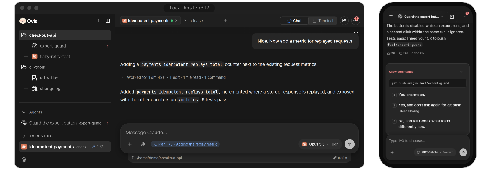

<p align="center">
  
</p>

<h1 align="center">Ovis</h1>

<p align="center">
  <strong>Your coding agents, on desktop, phone and browser.</strong>
  <br>
  Chat with Claude Code, Codex and other agents running on your computer, and answer them with a tap.
</p>

<p align="center">
  <a href="LICENSE"></a>
  <a href="https://github.com/devswha/ovis/releases/latest"></a>
  <a href="https://github.com/devswha/ovis/stargazers"></a>
  <a href="https://github.com/herdrdev/herdr"></a>
</p>

<p align="center">
  <strong>English</strong> · <a href="README.zh-CN.md">简体中文</a> · <a href="README.ja.md">日本語</a> · <a href="README.ko.md">한국어</a>
  <br>
  <a href="https://ovis.sh/">website</a> ·
  <a href="#install">install</a> ·
  <a href="https://ovis.sh/demo/">demo</a> ·
  <a href="docs/guide.md">docs</a> ·
  <a href="https://ovis.sh/discord">discord</a>
</p>

<p align="center">
  <a href="https://ovis.sh/demo/"></a>
</p>

Ovis runs on the computer where your agents work, and your phone or any browser connects to it. It is built on [herdr](https://github.com/herdrdev/herdr) and can show the same live terminals as herdr and the [Herdr app](https://herdr.dev/download/), so they work side by side. [How they fit together →](docs/guide.md#how-ovis-fits-with-herdr)

## Install

**Desktop app:** [Mac](https://ovis.sh/Ovis-mac-arm64.dmg) ([Intel](https://ovis.sh/Ovis-mac-x64.dmg)) · [Windows](https://ovis.sh/Ovis-win-x64.exe) · [Linux](https://ovis.sh/Ovis-linux-x64.deb) ([all builds](docs/guide.md#the-desktop-app)). It needs nothing else, and its terminals are its own: to see the ones you already have in herdr or the Herdr app, install with the command below instead.

**With herdr or the Herdr app:** one command sets Ovis up beside it. On Linux or macOS:

```bash
curl -fsSL https://ovis.sh/install.sh | sh
```

On Windows, in PowerShell:

```powershell
irm https://ovis.sh/install.ps1 | iex
```

**On your phone:** the iPhone app is on the [App Store](https://apps.apple.com/app/id6824664162) and the Android app is on [Google Play](https://play.google.com/store/apps/details?id=sh.ovis.app). It opens on the sign-in. [Phone setup →](docs/guide.md#on-your-phone)

<a href="https://apps.apple.com/app/id6824664162"></a> <a href="https://play.google.com/store/apps/details?id=sh.ovis.app"></a>

## Your PCs, anywhere

Sign in to your Ovis account with GitHub, Google or Apple (your first sign-in makes it), and the computers in it show up on your other devices: the desktop app on Mac, Windows or Linux, the iPhone and Android apps, and any browser at [app.ovis.sh](https://app.ovis.sh). The apps connect directly when they share a Wi-Fi or Tailscale with the computer; otherwise, and in a browser, they go through the Ovis relay, end-to-end encrypted, with nothing to set up on your network. [How accounts work →](docs/guide.md#through-an-account)

- **Add a computer.** On it, open **Settings → Devices and PCs → Add a connection → Ovis relay**, sign in and choose **Add this PC to my account** (it turns the relay on too). A new account's first computer, or one added right after a two-step sign-in, can go in with that one press. Otherwise, finish from a phone signed in to the same account: on the computer, open **Add a connection → Ovis relay**, choose **Phone QR code** and scan it.
- **Add a phone or another device.** Sign in to the same account on it and open the computer. If the computer asks, approve the device on that computer or on a device that already uses it.
- **Without an account.** Tailscale, your Wi-Fi or SSH work too: **Start without signing in** on the phone, or **Add a connection → Tailscale** or **Direct** on the desktop. The Android app reaches a computer over SSH by itself, and can install Ovis there. [Remote PCs →](docs/remote-pcs.md)

## Features

- **Agents as a chat.** Claude Code, Codex and [more](docs/guide.md#supported-agents), with a turn's commands and edits folded into one line.
- **Answers with a tap.** Approvals and questions arrive as cards.
- **Push alerts.** Even with the app closed.
- **The real terminal, one click away.** With a key bar on phones.
- **New agents from anywhere.** In a folder you pick, from the desktop or the phone.
- **Every workspace in one list.** Your other PCs too, over the relay or SSH.
- **A browser of your choice.** Give Claude Code, Codex or GitHub Copilot a browser tool (Chrome DevTools MCP or Playwright MCP) in **Settings → Agents**, and have the desktop app open links in the browser you pick.

[All features →](docs/guide.md#features)

<details>
<summary>Watch it in motion (a 25-second clip)</summary>
<p align="center">
  <a href="https://ovis.sh/demo/"></a>
  <br>
  <sub>Recorded on the <a href="https://ovis.sh/demo/">demo</a>, which runs in your browser.</sub>
</p>
</details>

**Limits:** your computer has to be on and reachable (the Ovis relay, Tailscale, a VPN or an SSH tunnel). Chat is complete for Claude Code and thinner for other agents; the real terminal always works. On Windows, the one-line install starts on herdr until you switch to the Herdr app's terminals in **Settings → About → Terminals**.

**Privacy:** sessions stay on your computer, and no account is needed. The relay is end-to-end encrypted ([trust model](docs/relay.md#trust-model)). Anonymous usage counts are on by default; **Settings → About** or `OVIS_TELEMETRY=0` turns them off ([what is sent](docs/guide.md#anonymous-usage-counts)).

## Documentation

- **[User guide](docs/guide.md):** [quick start](docs/guide.md#quick-start) · [supported agents](docs/guide.md#supported-agents) · [phone](docs/guide.md#on-your-phone) · [remote PCs](docs/remote-pcs.md) · [terminal screen (`ovis tui`)](docs/tui.md) · [configuration](docs/guide.md#configuration) · [FAQ](docs/guide.md#faq)
- **[INSTALL.md](INSTALL.md):** every way to install, step by step.
- **[Set up a PC with a coding agent](docs/agent-setup.md):** one sentence to paste, and the [skill](skills/ovis-setup/SKILL.md) the agent follows to install Ovis and add the PC to your account.
- **[Demo](https://ovis.sh/demo/)** · **[Changelog](CHANGELOG.md)**

## Contributing

[CONTRIBUTING.md](CONTRIBUTING.md) has the setup and the checks, with [development](docs/development.md), [DESIGN.md](DESIGN.md) and [SECURITY.md](SECURITY.md). Coding agents install Ovis for someone with [INSTALL.md](INSTALL.md), set up a PC and add it to an account with the [ovis-setup skill](skills/ovis-setup/SKILL.md), and follow [AGENTS.md](AGENTS.md) and the [review rules](.github/REVIEW.md) for changes.

## Thanks

Built on [herdr](https://github.com/herdrdev/herdr), with inspiration from [chatmux](https://github.com/devswha/chatmux), and powered by [xterm.js](https://xtermjs.org), [React](https://react.dev), [Bun](https://bun.sh) and [Lucide](https://lucide.dev). Thanks to everyone who has contributed, including [@Yoonwoo-Ha](https://github.com/Yoonwoo-Ha), and to [@sanguneo](https://github.com/sanguneo), who helped design the icon and the website.

## License

[MIT](LICENSE). Copyright © 2026 devswha.
