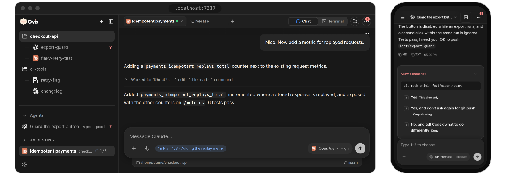

<p align="center">
  
</p>

<h1 align="center">Ovis</h1>

<p align="center">
  <strong>你的编程智能体，在桌面、手机和浏览器上。</strong>
  <br>
  与在你电脑上运行的 Claude Code、Codex 等智能体聊天，轻点一下即可回答。
</p>

<p align="center">
  <a href="LICENSE"></a>
  <a href="https://github.com/devswha/ovis/releases/latest"></a>
  <a href="https://github.com/devswha/ovis/stargazers"></a>
  <a href="https://github.com/herdrdev/herdr"></a>
</p>

<p align="center">
  <a href="README.md">English</a> · <strong>简体中文</strong> · <a href="README.ja.md">日本語</a> · <a href="README.ko.md">한국어</a>
  <br>
  <a href="https://ovis.sh/">官网</a> ·
  <a href="#install">安装</a> ·
  <a href="https://ovis.sh/demo/">演示</a> ·
  <a href="docs/guide.md">文档</a> ·
  <a href="https://ovis.sh/discord">Discord</a>
</p>

<p align="center">
  <a href="https://ovis.sh/demo/"></a>
</p>

Ovis 运行在智能体所在的那台电脑上，手机或任意浏览器都可以连接到它。它基于 [herdr](https://github.com/herdrdev/herdr) 构建，能显示你在 herdr 或 [Herdr 应用](https://herdr.dev/download/)里看到的同一批实时终端，所以两者可以同时使用。[它们之间的关系 →](docs/guide.md#how-ovis-fits-with-herdr)

<a id="install"></a>

## 安装

**桌面应用：** [Mac](https://ovis.sh/Ovis-mac-arm64.dmg)（[Intel](https://ovis.sh/Ovis-mac-x64.dmg)）· [Windows](https://ovis.sh/Ovis-win-x64.exe) · [Linux](https://ovis.sh/Ovis-linux-x64.deb)（[全部版本](docs/guide.md#the-desktop-app)）。无需安装其他东西。它只显示自己启动的终端；想看到 herdr 或 Herdr 应用里已有的终端，请改用下面的命令安装。

**已经在用 herdr 或 Herdr 应用：** 一条命令即可把 Ovis 装在它旁边。在 Linux 或 macOS 上运行：

```bash
curl -fsSL https://ovis.sh/install.sh | sh
```

在 Windows 上，用 PowerShell 运行：

```powershell
irm https://ovis.sh/install.ps1 | iex
```

**在手机上：** iPhone 应用已在 [App Store](https://apps.apple.com/app/id6824664162) 上架，Android 应用已在 [Google Play](https://play.google.com/store/apps/details?id=sh.ovis.app) 上架。打开应用就是登录页。[手机设置 →](docs/guide.md#on-your-phone)

<a href="https://apps.apple.com/app/id6824664162"></a> <a href="https://play.google.com/store/apps/details?id=sh.ovis.app"></a>

## 随时随地访问你的电脑

用 GitHub、Google 或 Apple 登录你的 Ovis 账户（第一次登录即创建账户），账户里的电脑就会出现在你的其他设备上：Mac、Windows、Linux 上的桌面应用，iPhone 和 Android 应用，以及任意打开 [app.ovis.sh](https://app.ovis.sh) 的浏览器。应用与电脑在同一 Wi-Fi 或 Tailscale 上时直接连接；否则以及在浏览器中，通过端到端加密的 Ovis 中继连接，网络上无需任何设置。[账户如何工作 →](docs/guide.md#through-an-account)

- **添加电脑。** 在这台电脑上打开 **设置 → 设备和电脑 → 账户**，登录并添加此电脑。新账户的第一台电脑，或刚完成两步登录后添加的电脑，可以一键加入。否则，用登录了同一账户的手机完成：在电脑上打开 **添加连接 → 手机和设备**，开启中继，点击 **显示这个二维码** 并扫描。
- **添加手机或其他设备。** 在该设备上登录同一账户并打开电脑。如果电脑要求批准，就在这台电脑上，或在已经在用它的设备上批准。
- **不用账户。** 也可以用 Tailscale、同一 Wi-Fi 或 SSH：在手机上选 **不登录直接开始**，在桌面上选 **添加连接 → Tailscale** 或 **直接连接**。Android 应用可以自己通过 SSH 连接电脑，还能在那里安装 Ovis。[远程电脑 →](docs/remote-pcs.md)

## 功能

- **以聊天方式使用智能体。** Claude Code、Codex [等](docs/guide.md#supported-agents)。每一轮的命令和修改会折叠成一行。
- **审批和提问以卡片呈现。** 轻点即可回答。
- **推送通知。** 应用关闭时也能收到。
- **真正的终端，一键即达。** 手机上还有按键栏。
- **随时随地启动新智能体。** 在桌面或手机上选好文件夹即可。
- **所有工作区，一个列表。** 也包括通过中继或 SSH 连接的你的其他电脑。
- **用你选的浏览器。** 在 **设置 → Agent** 中给 Claude Code、Codex 或 GitHub Copilot 配上浏览器工具（Chrome DevTools MCP 或 Playwright MCP），桌面应用也能用你选的浏览器打开链接。

[全部功能 →](docs/guide.md#features)

<details>
<summary>看看实际操作（25 秒的录屏）</summary>
<p align="center">
  <a href="https://ovis.sh/demo/"></a>
  <br>
  <sub>录制自可在浏览器中运行的<a href="https://ovis.sh/demo/">演示</a>。</sub>
</p>
</details>

**限制：** 你的电脑需要开着并且能被访问（Ovis 中继、Tailscale、VPN 或 SSH 隧道）。聊天功能在 Claude Code 上是完整的，在其他智能体上要少一些；真正的终端始终可用。在 Windows 上，一行安装命令会先使用 herdr，可以在 **设置 → 关于 → 终端** 中切换到 Herdr 应用的终端。

**隐私：** 会话留在你的电脑上，不需要账户。中继采用端到端加密（[信任模型](docs/relay.md#trust-model)）。匿名使用计数默认启用，可在 **设置 → 关于** 中关闭，或设置 `OVIS_TELEMETRY=0`（[发送哪些内容](docs/guide.md#anonymous-usage-counts)）。

## 文档

- **[用户指南](docs/guide.md)：** [快速入门](docs/guide.md#quick-start) · [支持的智能体](docs/guide.md#supported-agents) · [手机](docs/guide.md#on-your-phone) · [远程电脑](docs/remote-pcs.md) · [配置](docs/guide.md#configuration) · [常见问题](docs/guide.md#faq)
- **[INSTALL.md](INSTALL.md)：** 所有安装方式的分步说明。
- **[演示](https://ovis.sh/demo/)** · **[更新日志](CHANGELOG.md)**

文档以英文撰写。

## 参与贡献

环境准备和检查步骤见 [CONTRIBUTING.md](CONTRIBUTING.md)，另可参考[开发文档](docs/development.md)、[DESIGN.md](DESIGN.md) 和 [SECURITY.md](SECURITY.md)。编程智能体在帮人安装时遵循 [INSTALL.md](INSTALL.md)，修改仓库时遵循 [AGENTS.md](AGENTS.md) 和[评审规则](.github/REVIEW.md)。

## 致谢

本项目基于 [herdr](https://github.com/herdrdev/herdr) 构建，灵感来自 [chatmux](https://github.com/devswha/chatmux)，并使用了 [xterm.js](https://xtermjs.org)、[React](https://react.dev)、[Bun](https://bun.sh) 和 [Lucide](https://lucide.dev)。感谢所有贡献者，包括 [@Yoonwoo-Ha](https://github.com/Yoonwoo-Ha)，也感谢帮助设计图标和网站的 [@sanguneo](https://github.com/sanguneo)。

## 许可证

[MIT](LICENSE). Copyright © 2026 devswha.
